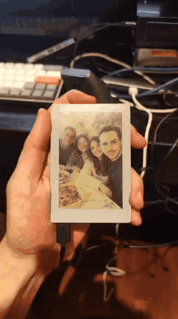

# the familly i never had

A dystopian e-ink installation for the M5Stack PaperColor. One persistent
subject — a real person, from one uploaded photograph — is placed every night
into a completely new, invented family: new partner, new children, new scene.
Nothing carries over. The previous household is overwritten and never kept.

<p align="center">
  
</p>
<p align="center"><em>A household being reassigned (sped up; the 30 s generation wait is compressed).
<a href="media/demo.mp4">Full video, 68 s</a>.</em></p>

Everything runs on the device: it sends the subject's photo to the OpenAI
image-edit API, receives the picture, dithers it to the six Spectra 6 ink
colours, stores it on SD and refreshes the panel.

**Status: v0.8.** The pipeline and web UI work on hardware. The device has now
been used for three consecutive days without recharging, and fresh image
generation is working. This is encouraging real-world evidence that battery
savings are effective, not a controlled battery-life measurement. See Status
and Roadmap for what remains to verify.

## How it works

    subject photo (SD)
      -> trigger: night slot | top button | dashboard | subject replaced
      -> OpenAI images/edits (gpt-image, 1024x1536, verified TLS)
      -> base64 JPEG decoded in PSRAM
      -> serpentine Floyd–Steinberg dither to 6 colours (400x600)
      -> SD (FAM6 frame) -> Spectra 6 refresh

## Features (v0.8)

- **On-device generation** — multipart request built and the base64 response
  decoded in PSRAM; certificate-bundle TLS (no `setInsecure()`); the key is
  never logged and error text is redacted.
- **Nightly household** — one assignment per night at a chosen hour (default
  03:00), 3-hour window, up to 3 retries 20 min apart. Clock from NTP, kept in
  the RX8130 RTC (UTC) across power-offs.
- **New subject, new family** — registering or replacing the photo immediately
  assigns a new household.
- **Pose variety** — each prompt combines one of 25 scenes, 12 head poses and
  6 camera framings, and asks the model not to copy the reference's pose,
  expression, clothing or framing while keeping identity and apparent age.
- **Subject upload** — from the dashboard; the browser resizes to ≤1024 px JPEG
  (strips metadata), the device validates and fully decodes it before
  committing, and an explicit consent checkbox is required.
- **Gallery web UI** — dashboard shows the current household as a framed plate
  with caption (household Nº, scene, time, origin: night / request / subject),
  state, subject, night hour and power. Same design for the subject and setup
  pages; no external fonts or scripts.
- **Wi-Fi onboarding** — WPA2 setup hotspot with a random password shown only
  on the e-ink; credentials kept in NVS.
- **Power** — on USB always awake. On battery: awake while used (4 min idle,
  10 min with setup open, 40 s after a night assignment), then full M5PM1
  power-off with the image left on the panel, scheduling its own wake for the
  next night. The owner has observed three consecutive days of operation
  without recharging, with fresh image generation; see Status for the limits
  of that evidence.
- **Dystopian states** — "We don't know who you are yet.", "Your authorization
  could not be verified.", "No family could be assigned tonight.", …

## Hardware

- M5Stack PaperColor (C151): ESP32-S3R8, 16 MB flash, 8 MB PSRAM,
  400×600 Spectra 6 (ED2208), RX8130 RTC, M5PM1 power management, battery.
- microSD card (FAT32) — stores the subject photo and the current frame.

## Building

- Arduino CLI, core `m5stack:esp32` (tested 3.3.9)
- Libraries: M5Unified (0.2.21), M5GFX (0.2.28), M5PM1 (1.0.7)
- FQBN: `m5stack:esp32:m5stack_papercolor:USBMode=hwcdc,CDCOnBoot=cdc,PSRAM=opi,FlashSize=16M`

```
arduino-cli lib install M5Unified M5GFX M5PM1
cp familly_v0_8/openai.h.example familly_v0_8/openai.h   # then paste your key
arduino-cli compile --fqbn m5stack:esp32:m5stack_papercolor:USBMode=hwcdc,CDCOnBoot=cdc,PSRAM=opi,FlashSize=16M familly_v0_8
arduino-cli upload -p /dev/ttyACM0 --fqbn m5stack:esp32:m5stack_papercolor:USBMode=hwcdc,CDCOnBoot=cdc,PSRAM=opi,FlashSize=16M familly_v0_8
```

Without `openai.h` the firmware still builds and runs, but shows
"Your authorization could not be verified." instead of generating.

Timezone: `FAMILY_TZ` / `FAMILY_UTC_OFFSET_MIN` in `power_manager.h`
(default `CST6` / -360, no DST).

## Local secrets

Two files, both ignored by Git, live next to the `.ino`:

| File | Required | Contents |
| --- | --- | --- |
| `openai.h` | yes | `FAMILY_OPENAI_API_KEY` — an OpenAI API key (platform.openai.com) |
| `wifi.h` | no | `FAMILY_WIFI_SSID` / `FAMILY_WIFI_PASSWORD` — otherwise use the setup hotspot |

Copy them from the `.example` files. Compiled-in values can be extracted from
the firmware or a flash dump: use a dedicated API key with a low spending
limit, and never publish build output.

## First run

1. Insert the microSD card and flash the firmware.
2. With no Wi-Fi configured the panel shows a hotspot name and password. Join
   it, open `http://192.168.4.1`, enter your 2.4 GHz Wi-Fi.
3. Open the address shown on the panel (the dashboard).
4. **Replace the subject** → choose a clear photo of one person → tick consent
   → **Register the subject**. A first household is assigned immediately
   (about 65 s: ~20 s OpenAI, ~16 s panel refresh).

## Controls quick map

| Input | Action |
| --- | --- |
| first user button clicked | learned as the "top" button |
| top button | assign another household |
| other user buttons | redraw the current household |
| hold any user button 3 s | reopen the setup hotspot |
| power button | wake from power-off |
| dashboard | assign, set night hour, replace subject, keep awake |

USB serial (115200): `NETSTATUS`, `GENSTATUS`, `FACESTATUS`, `POWERSTATUS`,
`STORESTATUS`, `GENERATE`, `DISPLAY`, `SETUP`, `SLEEPTEST <s>`.

## Status

Verified on hardware: device-side generation from the stored subject,
automatic regeneration when the subject changes, persistent caption, USB /
battery detection, NTP → RTC sync, LAN authorization checks, full M5PM1
power-off.

Owner-reported field use: three consecutive days without recharging, with fresh
image generation working. This is evidence of useful real-world battery
runtime, but no start/end charge measurements were recorded, so it is not a
measured battery-life result. It also does not establish that the scheduled RTC
wake caused each generation.

Still to verify in a controlled test:
- **Autonomous wake from power-off.** An RTC-countdown wake on PM1 GPIO2 did not
  power the board back on in testing (recovered with the power button). v0.8
  also arms the M5PM1 power-on timer and logs every PM1 return code, but this
  specific wake path has not been verified. `SLEEPTEST 30` deliberately powers
  the device off; run it only when someone can press the power button if it does
  not wake by itself.
- A scheduled overnight assignment triggered by the RTC.
- Battery-life measurement from recorded charge levels / runtime, and how well
  the subject's identity is preserved across many generations.

Cost: about $0.013 per image (estimated from token counts at medium quality).

## Privacy and security

- The subject photo is sent to OpenAI on every generation.
- The photo is stored **unencrypted** on the SD card; deleting it is not
  secure erasure.
- Anyone on the same Wi-Fi who can reach the dashboard can trigger paid
  generations or replace the subject. Use a trusted network.
- The API key in the firmware can be extracted from the device.

## Roadmap

- Better prompts and generations: richer prompt/image interaction, several
  reference photos of the subject for a more faithful likeness.
- Larger, higher-resolution e-ink panel.
- Proven battery self-wake and measured battery life.
- Encrypted storage, secure deletion, stronger dashboard protection.

## Layout

- `familly_v0_8/` — current firmware + CHANGES.md
  - `familly_v0_8.ino` — Wi-Fi, setup hotspot, web server, main loop
  - `native_generation.h` — OpenAI worker, dithering, SD, display
  - `openai_codec.h` — multipart builder and base64 decoding
  - `prompt_rules.h` — scene / pose / framing pools
  - `schedule_rules.h`, `power_manager.h` — night schedule, RTC, power-off
  - `face_upload.h`, `reference_rules.h` — subject upload and JPEG validation
  - `web_ui.h` — dashboard, subject and setup pages
  - `dither_core.h`, `sd_image_bridge.h`, `storage_commands.h` — panel, SD, USB tools
  - `openai.h.example`, `wifi.h.example` — templates for the local secrets
- `media/` — demo GIF and video (audio removed)
